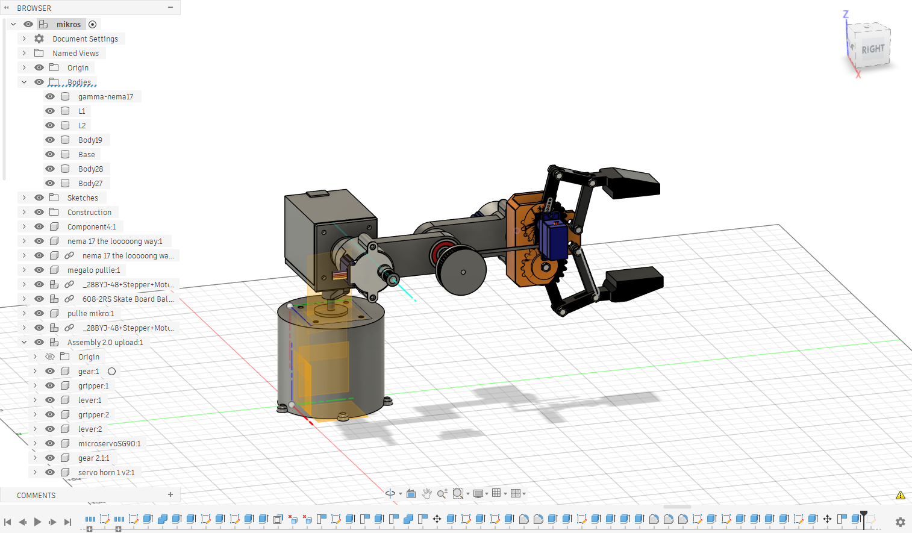

# small_actuator — 5-Actuator Desktop Robotic Arm

A compact, 3D-printed desktop robotic arm with four pitch/yaw joints and a servo-driven gripper. Mechanical design is complete and all parts are printed; electronics, firmware and ROS 2 integration are the next milestones.

<p align="center">
  
</p>

## Status

| Milestone | State |
|---|---|
| Mechanical design (Fusion 360) | Done |
| 3D printing of all parts | Done |
| Assembly and wiring | Planned |
| Firmware (stepper + servo control) | Planned |
| URDF model and RViz / MoveIt 2 simulation | In progress |
| ROS 2 control (`ros2_control`, micro-ROS) | Planned |
| Pick-and-place demo | Planned |

## Kinematic Structure

| # | Joint | Motion | Actuator |
|---|---|---|---|
| 1 | Base | Yaw (rotation about Z) | NEMA 17 stepper (42BYGH603) |
| 2 | Shoulder | Pitch | NEMA 17 stepper (42BYGH603) |
| 3 | Elbow | Pitch | 28BYJ-48 geared stepper |
| 4 | Wrist | Pitch | 28BYJ-48 geared stepper |
| 5 | Gripper | Open / close | SG90 micro servo |

## Repository Layout

```
cad/
  fusion/   Fusion 360 source (gripper)
  step/     Full assembly, STEP
  stl/      Printable parts: base, gamma-nema17, L1, L2, grabberbase
docs/
  images/   Renders and photos
hardware/   Bill of materials and wiring (to be added)
```

## Design Notes

- Printed with a Bambu Lab printer; all structural parts are single-piece STL exports.
- STL files use millimetres. When loading them into a URDF, apply `scale="0.001 0.001 0.001"`.
- Each STL is exported in its own local frame. For simulation, joint origins must be taken from the STEP assembly.

## Roadmap

1. Assemble the arm and run one motor per joint.
2. Write the bill of materials and wiring diagram.
3. Firmware for the controller (step/dir pulses, homing, limits).
4. URDF with `ros2_control` (mock hardware first), RViz and MoveIt 2.
5. Closed-loop control and a pick-and-place demo.

## Author

Vasileios Karagiannidis — Computer Engineering, International Hellenic University
[GitHub](https://github.com/karagiancode) · [Portfolio](https://karagiancode.github.io/)
