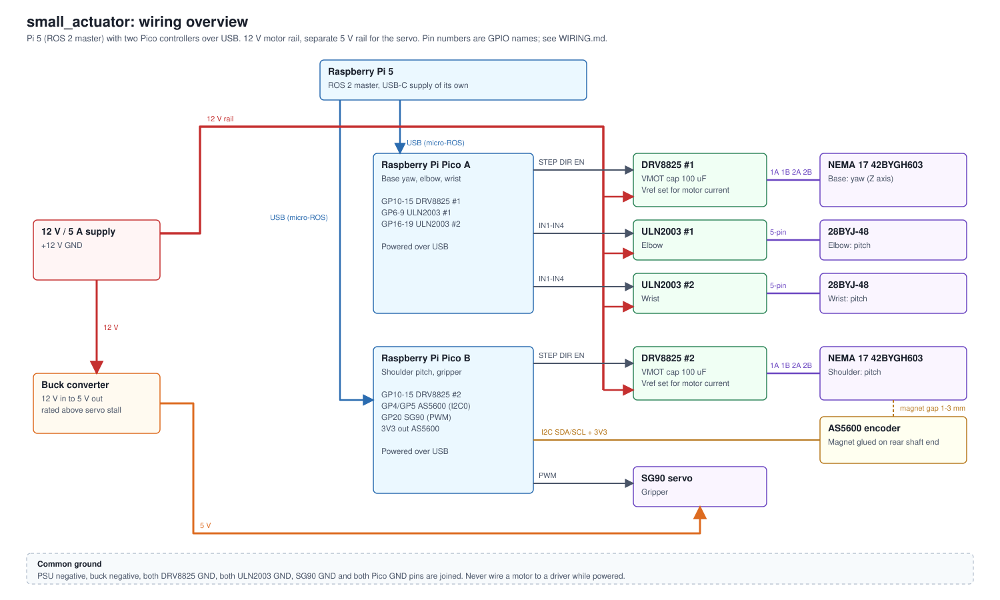

# Wiring

## Architecture

| Controller | Drives | Notes |
|---|---|---|
| Raspberry Pi 5 | ROS 2 master | Own USB-C supply. Connects to each Pico over USB (micro-ROS). |
| Pico A | Base yaw and shoulder pitch (NEMA 17), AS5600 encoder | Powered over USB. Drives the CNC shield. |
| Pico B | Elbow and wrist (28BYJ-48), gripper (SG90) | Powered over USB. Drives two ULN2003 boards. |

## Pico A pinout (NEMA 17 joints)

| Function | GPIO | Physical pin | Connects to |
|---|---|---|---|
| STEP, base | GP10 | 14 | Driver 1 STEP on the CNC shield |
| DIR, base | GP11 | 15 | Driver 1 DIR |
| STEP, shoulder | GP12 | 16 | Driver 2 STEP |
| DIR, shoulder | GP13 | 17 | Driver 2 DIR |
| ENABLE | GP14 | 19 | Shield EN (shared by all drivers, active low) |
| I2C0 SDA | GP4 | 6 | AS5600 SDA |
| I2C0 SCL | GP5 | 7 | AS5600 SCL |
| 3V3 (OUT) | | 36 | AS5600 VCC |
| Reserved | GP15, GP16, GP17 | 20, 21, 22 | Future limit switches |
| GND | | 38 | Common ground |

## Pico B pinout (small joints)

| Function | GPIO | Physical pin | Connects to |
|---|---|---|---|
| IN1 to IN4 | GP6, GP7, GP8, GP9 | 9, 10, 11, 12 | ULN2003 board #1 (elbow) |
| IN1 to IN4 | GP16, GP17, GP18, GP19 | 21, 22, 24, 25 | ULN2003 board #2 (wrist) |
| Servo PWM | GP20 | 26 | SG90 signal |
| GND | | 38 | Common ground |

## CNC Shield V3

The shield is an Arduino Uno shield used here without an Arduino. It supplies the DRV8825 sockets, the motor power terminal and the microstep jumpers.

- **Power:** the 12-36 V screw terminal takes the 12 V rail. Check the polarity marking on the board before connecting.
- **Signals:** on the standard GRBL layout the signals come from the Uno pins X STEP D2, Y STEP D3, Z STEP D4, X DIR D5, Y DIR D6, Z DIR D7 and EN D8. Wire the Pico GPIOs to those same signals at the shield pins. Confirm each one against the silkscreen or with a multimeter before powering.
- **Driver slots:** this plan uses slot X for the base and slot Y for the shoulder. Any two slots work as long as STEP and DIR follow the slot used.
- **Microstepping:** set with jumpers under each driver (M0, M1, M2). For the DRV8825, no jumpers is full step and all three is 1/32. The Pico does not control these pins.
- **Enable:** the shield has a single EN line shared by all drivers.
- **Current limit:** three DRV8825 modules are fitted and two are used. Set the reference voltage of each used driver before connecting its motor. The formula depends on the sense resistor of your module, so check it first.
- **3.3 V logic:** Pico outputs 3.3 V, which the DRV8825 accepts. Pico pins are not 5 V tolerant, so never connect the shield 5 V pin to a Pico and never feed a shield signal into a Pico input without checking its level.
- **Capacitor:** make sure a bulk capacitor of about 100 uF is present across the motor supply. Add one if the shield has none.
- **Motor coils:** each NEMA 17 has two coils. Find the pairs with a multimeter (low resistance between the two wires of one coil) before plugging the motor into the driver.

## ULN2003 boards and 28BYJ-48

The boards are the 7-channel type (IN1 to IN7, labelled 5-12 V). Only IN1 to IN4 are used. The four LEDs show which coil is energised, which is useful for first tests.

- IN1 to IN4 to the four Pico pins above, in order.
- Power the board through its two power pins with the 12 V rail only if the motor is the 12 V version. A 5 V motor needs 5 V.
- Drive with the half-step sequence for smoother motion.

## SG90 servo

- Red to 5 V from the buck converter, brown to ground, orange to GP20.
- Add a 470 uF capacitor across the 5 V rail near the servo to absorb current spikes.

## AS5600 encoder (shoulder)

- VCC to Pico A 3V3, GND to ground, SDA to GP4, SCL to GP5. Tie the DIR pin of the module to ground.
- I2C address is fixed at 0x36.
- The magnet is a 6 x 2.5 mm diametrically magnetised disc, glued centred on the flat rear end of the motor shaft. A small printed jig helps centre it.
- The sensor sits 1 to 3 mm from the magnet. Read the magnet status bits of the AS5600 to confirm the field strength is in range.
- The encoder measures the motor shaft angle. If the shoulder is driven through the GT2 belt, the joint angle is the motor angle divided by the belt ratio.

## Power and ground

- 12 V rail: PSU to the CNC shield terminal and the two ULN2003 boards (12 V motors only).
- 5 V rail: buck converter to the SG90 only.
- The Pi 5 uses its own USB-C supply and powers both Picos over USB.
- Join all grounds: PSU negative, buck negative, CNC shield GND, both ULN2003 GND, SG90 and both Pico GND pins.

## First power-up checklist

1. Verify the 28BYJ-48 voltage version from the label.
2. Set the DRV8825 current limit with the motors disconnected.
3. Power off, connect one motor, power on, and step it slowly in both directions.
4. Repeat joint by joint before connecting everything.
5. Add the encoder only after the shoulder motor runs open loop.
